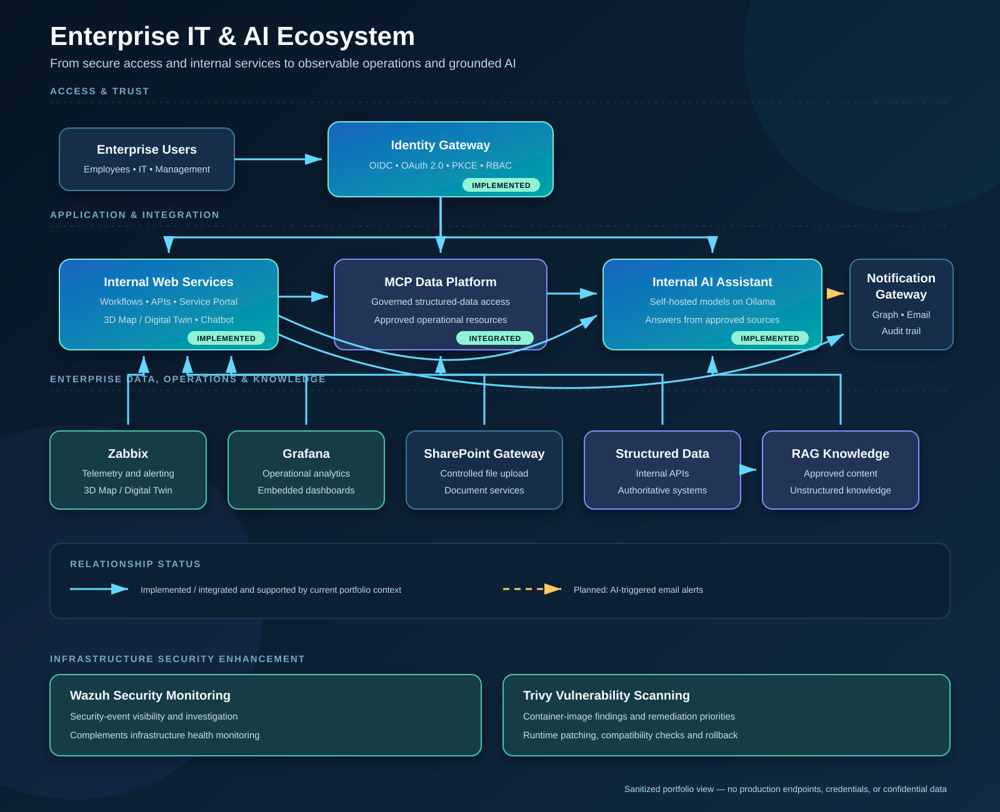

# Yuttasin Srisangchan | Enterprise IT, Security & Digital Transformation

IT leader with 17+ years of experience across healthcare, consumer lending, fresh food wholesale and retail, pharmaceutical and medical supplies distribution, and exhibition and convention operations. I lead infrastructure and security projects and build internal services that turn manual work into trackable workflows.

## Career highlights

| Achievement | Scope |
| --- | --- |
| **R2I 2026 winner** | The Best System & Process Innovation Award |
| **6,000+ branch locations** | Managed enterprise infrastructure supporting a nationwide branch network |
| **400+ mailboxes migrated** | Led an Exchange Hybrid migration to Microsoft 365 while retaining 300+ mailboxes on-premises |
| **Hospital infrastructure** | Implemented network and security infrastructure at Rajavithi Hospital, with familiarity with basic HIS and RIS workflows |
| **Team leadership** | Managed and mentored five direct reports across programming, systems analysis, SAP support, and infrastructure |
| **Enhanced infrastructure security** | Wazuh security monitoring and Trivy vulnerability scanning, supported by Zabbix monitoring and alerting and Grafana operational dashboards |

## Projects and status

| Project | What it helps people do | Status |
| --- | --- | --- |
| [IT Services Portal](projects/it-services-platform.md) | Submit and track IT requests, approvals, procurement, and other employee services | In use and evolving |
| [Meeting Room Booking & Analytics](projects/meeting-room-analytics.md) | Book rooms, manage approvals, and review utilization | In production use |
| [Internal AI Assistant](projects/internal-ai-platform.md) | Ask questions about approved policies, service procedures, and supported operational data | Governed knowledge answers verified in production. Development continues |
| [Monitoring Portal](docs/architecture/README.md#monitoring-portal) | View Zabbix monitoring data and embedded Grafana dashboards in one web portal | Implemented |
| [Identity & SSO](projects/identity-sso-platform.md) | Sign in to internal applications through a shared identity service | Implemented. MCP Data Platform sign-in demonstrated |
| [Notification Gateway](projects/notification-gateway.md) | Send application email through an authenticated Microsoft Graph integration with delivery logging | Integrated. AI-triggered email alerts are planned |
| [Forms & approvals](projects/it-services-platform.md#workflow-design) | Create internal forms, surveys and quizzes, and route requests through approvals | Implemented as internal platform capabilities |
| [File services](docs/architecture/README.md#how-the-components-work-together) | Support controlled internal file transfer and SharePoint uploads | SharePoint upload integration demonstrated |
| [Infrastructure Security Enhancement](projects/infrastructure-security.md) | Monitor security events with Wazuh, scan container vulnerabilities with Trivy, and address known findings through runtime updates | Implemented. Monitoring and remediation continue |
| **Legacy Modernization & Telemetry Pipeline** | Upgrade legacy PHP web systems onto hardened containers and automate FTP/XML camera telemetry ingestion into MySQL analytics | Implemented in production |

## Enhanced infrastructure security

Enhanced infrastructure security through **Wazuh security monitoring** and **Trivy vulnerability scanning**, centralized infrastructure monitoring and alerting with **Zabbix**, and visualized operational metrics through **Grafana dashboards**.

| Tool or practice | Role |
| --- | --- |
| **Wazuh** | Security-event monitoring and investigation |
| **Trivy** | Container-image vulnerability scanning to inform remediation priorities |
| **Zabbix** | Infrastructure health monitoring and operational alerting |
| **Grafana** | Operational metrics and dashboards |
| **Runtime modernization** | PHP and Apache upgrades, application compatibility checks, and rollback preparation for legacy IoT workloads |

[Read the security enhancement case study](projects/infrastructure-security.md). Grafana is used for visualization; alerting is handled through Zabbix.

## How the systems connect

The Internal AI Assistant runs self-hosted language models on **Ollama** to keep company data within internal infrastructure and reduce dependence on paid model APIs. It uses retrieval-augmented generation (RAG) for approved knowledge and Model Context Protocol (MCP) for authorized data access. Planned email alerts include long-outstanding tasks, upcoming software license expirations, and cybersecurity advisories relevant to company systems. [See the Internal AI Assistant case study](projects/internal-ai-platform.md).

## Infrastructure, security & delivery

I lead projects from requirements and design through procurement, testing, deployment, and operational handover. My infrastructure work covers Cisco and multivendor networking, Nutanix and H3C hyperconverged infrastructure, VMware and Hyper-V, Microsoft 365, and secure identity. I also lead security monitoring (Wazuh), container vulnerability governance (Trivy), legacy workload modernization, vulnerability remediation and patch management, backup and recovery testing, and business continuity and disaster recovery planning.

[Professional learning and credentials](learning/README.md)

Portfolio examples are sanitized. Production endpoints, credentials, employee records, and proprietary source code are excluded.
