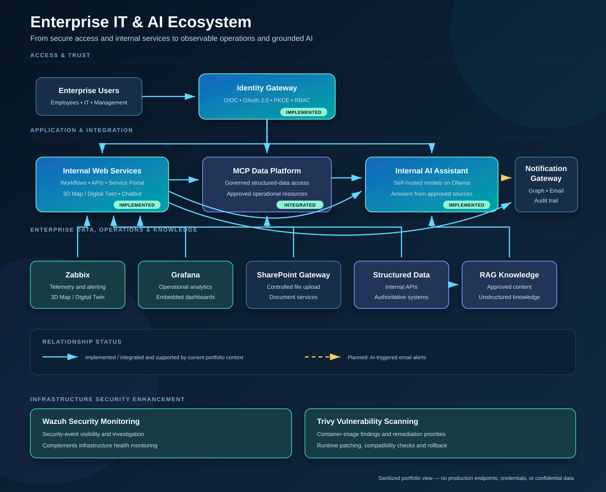

# Enterprise IT & AI Architecture

The diagram shows how shared identity, internal web services, monitoring, governed data, and notifications support employee workflows.

Solid blue lines show implemented or demonstrated integrations, including the Internal AI Assistant's access to published resources via the MCP Data Platform. Dashed amber shows the planned connection from AI analysis of changing data to email notifications.

## How the components work together

| Area | Role in the ecosystem | Demonstrated relationship |
|---|---|---|
| Identity Gateway | Central authentication and token validation using OIDC, OAuth 2.0, PKCE, RS256, and JWKS patterns | Provides reusable identity boundaries for internal applications; login integration with the MCP Data Platform has been proven |
| Internal Web Services | Employee workflows, service APIs, dashboards, the 3D operational view, and chatbot entry points | Integrates with SharePoint for file upload, embeds Grafana, consumes Zabbix data, and provides internal APIs |
| Notification Gateway | Central policy and audit boundary for application email | Internal applications call an authenticated API that delivers through Microsoft Graph |
| Zabbix & Grafana | Operational telemetry and visualization | Zabbix data supports the 3D map/digital-twin view; Grafana dashboards are embedded into internal services |
| SharePoint Gateway | Controlled document and file integration | Internal Web Services can upload files without exposing implementation credentials in the portfolio |
| MCP Data Platform & Structured Data | Governed access to authoritative operational information | the Internal AI Assistant queries published resources through the governed MCP interface |
| LLM / AI & RAG | Natural-language interaction over approved knowledge and operational data | RAG handles approved knowledge; MCP tools and internal APIs handle structured facts with deterministic formatting |

## Monitoring portal

The web portal displays infrastructure monitoring data and operational alerts from Zabbix and embeds Grafana dashboards through iframes. Grafana provides visualization; it is not used for alerting in this implementation. IT can review system health and availability in one place. Zabbix data also supports the 3D operational view described in this portfolio.

## Security enhancement

Wazuh provides security-event monitoring, while Trivy identifies known vulnerabilities in container images. These complement infrastructure monitoring and alerting with Zabbix and operational visualization with Grafana. The security section in the diagram describes these roles without implying unverified direct integrations between the scanners and other services.

Runtime upgrades, compatibility checks, and rollback preparation support remediation of legacy PHP and Apache workloads. [Security enhancement case study](../../projects/infrastructure-security.md).

## Evidence in this repository

- [Infrastructure Security Enhancement](../../projects/infrastructure-security.md)
- [Identity & SSO Platform](../../projects/identity-sso-platform.md)
- [IT Services Internal Digital Platform](../../projects/it-services-platform.md)
- [Meeting Room Booking & Operational Analytics](../../projects/meeting-room-analytics.md)
- [Notification Gateway Platform](../../projects/notification-gateway.md)
- [Internal AI Assistant](../../projects/internal-ai-platform.md)

> **Confidentiality note:** This diagram intentionally omits production hostnames, addresses, tenant details, credentials, sensitive records, and proprietary implementation details.
