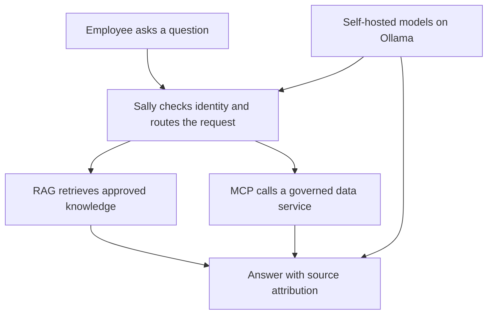

# Sally Internal AI

Sally helps employees find approved company information and ask questions about operational data they are authorized to access. The application runs self-hosted language models on Ollama, keeping company data within internal infrastructure and reducing dependence on paid external model APIs.

## What employees can do today

| Example question | Where the answer comes from |
| --- | --- |
| Which endpoint antivirus does the company use? | The published internal support resource |
| What should I do when the antivirus shows a pop-up? | The published troubleshooting item, with a link to the IT service desk |
| What is the status of a project? | Structured results from the project service where the user has authorized access |

The two endpoint-support questions were verified in production with source attribution. RAG and MCP are implemented for supported paths. Work continues on routing, follow-up questions, and additional sources.

## How an answer is produced

RAG retrieves relevant approved knowledge. MCP retrieves structured facts from the system that owns them. Supported structured responses use returned records for operational values and respect access boundaries. When the available evidence is insufficient or a reference is ambiguous, Sally can ask a follow-up or explain what it could verify.

## Planned use of changing data

The goal is to track relevant changes in approved operational data and send email when action is needed. Examples include tasks that have been open too long, software licenses approaching expiration, and cybersecurity advisories that match systems in use. Technology news can also be summarized for subscribers. The existing Notification Gateway provides an email delivery path. The automated analysis and alerting rules are planned.

## Implementation

Python, FastAPI, PostgreSQL, Redis, Docker, Ollama, RAG, MCP, internal REST APIs, and OIDC. Operational controls include runtime traces, source attribution, API outcome logging, and regression tests for routing and response behavior.

[Back to the portfolio](../README.md)
